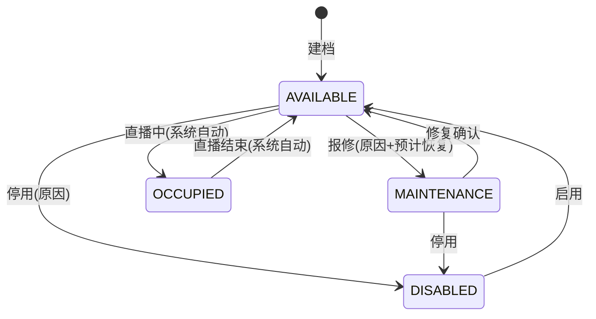
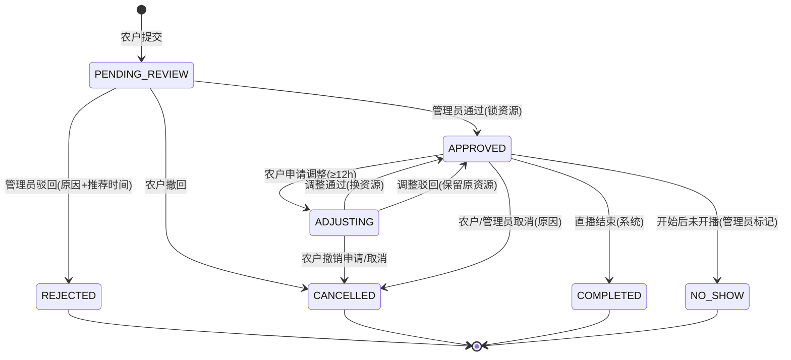
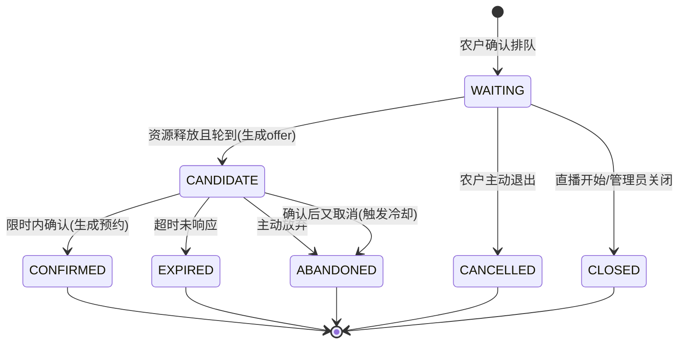
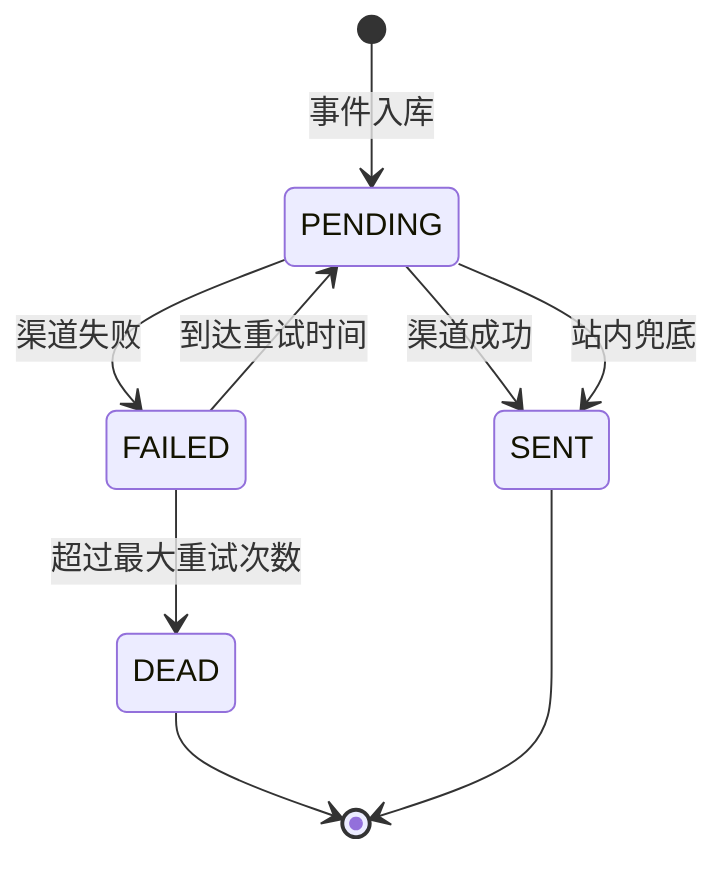

# 助农直播管理系统 · 业务规则与状态机

| 项 | 内容 |
|---|---|
| 文档编号 | R1-02 |
| 版本 | v1.0 |
| 编制/审核 | P1 / P2 |
| 约束级别 | **强制**。开发实现与测试用例不得偏离；偏离需走变更流程 |
| 关联 | SRS R1-01、DB D2-03、API D2-04、用例 T4-02 |

> 本文解决"同一句话有两种实现"的问题。所有规则均给出**判定条件、边界值、失败返回**，测试可直接照此设计反例。

---

## 1. 时间模型

### 1.1 基本约定

| 项 | 规则 |
|---|---|
| 时区 | 存储 UTC；业务计算与展示按 `Asia/Shanghai`；API 时间统一 ISO-8601 带 `+08:00` |
| 时段粒度 | 1 小时，`start`/`end` 必须整点（分钟秒为 0） |
| 区间语义 | **半开区间** `[start, end)`，10:00–12:00 占用 10:00、11:00 两个小时槽 |
| 跨天 | 禁止，`end` 必须与 `start` 同一天 |
| 时长 | 1–4 小时 |
| 提前量 | 开始时间 ≥ 当前时间 + 2 小时 |
| 预约窗口 | 开始时间 ≤ 当前时间 + 30 天 |
| 调整窗口 | 距开始 ≥ 12 小时可申请调整；**恰好 12:00 允许**（`>=`） |
| 开播提醒 | `T-60min`，容差 ±5 分钟，只发 1 次 |
| 审核截止 | 开始时间之后不得再审核通过（返回 `409`） |

### 1.2 小时槽展开

> 预约 `[10:00, 13:00)` → 槽位 `10:00, 11:00, 12:00`（3 个），不是 4 个。

```java
// 伪代码：槽位展开（开发按此实现）
List<LocalDateTime> slots(LocalDateTime start, LocalDateTime end) {
    List<LocalDateTime> r = new ArrayList<>();
    for (LocalDateTime t = start; t.isBefore(end); t = t.plusHours(1)) r.add(t);
    return r; // [start, end) 半开
}
```

**反例**：把 10:00–12:00 算成 3 个槽 → 与 12:00–13:00 的预约被判冲突，属实现错误。

---

## 2. 资源模型

### 2.1 资源构成

一次直播必须同时占用：**1 台设备 + 1 个场地**，且 `device.venue_id == booking.venue_id`。
任一资源不可用即整体不可约，不做"只占设备不占场地"的降级。

### 2.2 资源可用性判定

资源可被预约当且仅当同时满足：

1. 设备状态 = `AVAILABLE`（`MAINTENANCE`/`DISABLED`/`OCCUPIED` 不可）；
2. 场地状态 = `OPEN`；
3. 时段完全落在场地开放时段内（`venue.open_start ≤ start` 且 `end ≤ venue.open_end`）；
4. 该小时槽无有效占用记录（§3）；
5. 若 `device.calibration.block=true`，设备未过校准期；
6. 设备与场地归属一致。

### 2.3 设备状态机



- `OCCUPIED` 由系统按预约时间自动置位，人工不可直接设置。
- 维修/停用期间已有预约不自动取消，由管理员逐条处理并通知农户（**不静默取消**）。

---

## 3. 资源冲突判定（核心规则）

### 3.1 判定条件

对预约的每一个小时槽 `s`，检查：

```
冲突 ⇔ ∃ resource_lock(
    resource_type ∈ {DEVICE, VENUE}
    AND resource_id ∈ {deviceId, venueId}
    AND slot_start = s
    AND status = 'LOCKED'
)
```

设备或场地**任一**冲突 → 整单拒绝，返回 `409 RESOURCE_CONFLICT`，并列出全部冲突项。

### 3.2 数据库裁决（必须这样实现）

> **铁律**：唯一约束是最终裁决，Redis 只是前置拦截。禁止"先 SELECT 再 INSERT"裸奔。

```sql
-- resource_lock 表关键设计（MySQL 8.0）
CREATE TABLE resource_lock (
  id            BIGINT PRIMARY KEY AUTO_INCREMENT,
  resource_type VARCHAR(8)  NOT NULL,        -- DEVICE / VENUE
  resource_id   BIGINT      NOT NULL,
  slot_start    DATETIME    NOT NULL,
  booking_id    BIGINT      NOT NULL,
  status        VARCHAR(16) NOT NULL,        -- LOCKED / RELEASED
  active_flag   TINYINT GENERATED ALWAYS AS
                (IF(status = 'LOCKED', 1, NULL)) STORED,
  created_at    DATETIME    NOT NULL,
  UNIQUE KEY uk_resource_slot (resource_type, resource_id, slot_start, active_flag),
  KEY idx_booking (booking_id)
);
```

- 释放资源 = `UPDATE ... SET status='RELEASED'`，`active_flag` 变为 `NULL`；MySQL 唯一索引允许多个 NULL，历史可保留。
- 插入冲突时捕获 `DuplicateKeyException` → 事务回滚 → 返回 409。**不要吞异常**。

### 3.3 事务与锁顺序

```text
BEGIN
  1. 校验预约状态、农户资质、时段规则
  2. 按 (resource_type, resource_id, slot_start) 升序 批量插入 2N 条 resource_lock
  3. UPDATE booking SET status='APPROVED', version=version+1 WHERE id=? AND version=?
  4. INSERT outbox_event('BOOKING_APPROVED')
COMMIT
```

- **固定插入顺序**防死锁；捕获死锁异常（1213）自动重试 1 次。
- 审核通过与"调整生效"共用同一套加锁逻辑。
- Redis 前置：`SET lock:{type}:{id}:{slot} 1 NX EX 10`，失败直接 409；成功也必须继续走 DB 约束（防 Redis 丢数据）。

### 3.4 并发验收

| 场景 | 期望 |
|---|---|
| 100 并发同设备同时段提交 | 1 成功，99 个 409；`resource_lock` 无重复有效行 |
| 审核通过与取消并发 | 最终状态唯一，资源与状态一致 |
| 调整生效与候补确认并发 | 仅一方获得资源，另一方收到 409 并保留原状态 |

---

## 4. 状态机

### 4.1 预约状态机 `booking.status`



**允许的流转表**（其余一律 `409 INVALID_STATE`）：

| From \ To | APPROVED | REJECTED | ADJUSTING | CANCELLED | COMPLETED | NO_SHOW |
|---|---|---|---|---|---|---|
| PENDING_REVIEW | ✅ 管理员 | ✅ 管理员 | ❌ | ✅ 农户 | ❌ | ❌ |
| APPROVED | — | ❌ | ✅ 农户 | ✅ 双方 | ✅ 系统 | ✅ 管理员 |
| ADJUSTING | ✅ 审批 | ❌ | ❌ | ✅ 农户 | ❌ | ❌ |
| REJECTED / CANCELLED / COMPLETED / NO_SHOW | ❌ | ❌ | ❌ | ❌ | ❌ | ❌ |

- `NO_SHOW` 需管理员在开始后 24 小时内标记，需原因；影响农户信用统计（V1 仅展示，不做惩罚）。
- 每次流转写 `booking_status_history`（from/to/操作人/原因/时间/traceId）。

### 4.2 排队状态机 `queue_ticket.status`



- `CONFIRMED` 必须同时存在一条 `APPROVED` 预约；两者在**同一事务**内创建。
- `ABANDONED` 若由"确认后取消"产生，必须写 `queue_cooldown`（§7）。

### 4.3 调整单状态机 `booking_change.status`

`PENDING → APPROVED / REJECTED / CANCELLED`，终态不可再变。同一预约同时最多 1 条 `PENDING`。

### 4.4 通知状态机 `notification.status`



---

## 5. 排队与顺位算法

### 5.1 队列分组键

```
queue_group = (device_id, slot_date, slot_start)
```

同一设备、同一天、同一开始小时的排队者构成一个队列。场地不单独排队（设备是瓶颈资源，场地随设备绑定）。

### 5.2 排序与顺位

- 排序键：`created_at ASC, id ASC`（毫秒相同用 id 决胜）。
- 顺位：`position = 该组内 (created_at, id) 小于我 且 status ∈ {WAITING, CANDIDATE} 的数量 + 1`。
- 总人数：该组内 `status ∈ {WAITING, CANDIDATE}` 的数量。
- 预计等待场次：`position - 1`；`position=1` 显示"即将轮到您"。

```sql
-- 顺位查询（DB 权威口径）
SELECT COUNT(*) + 1 AS position
FROM queue_ticket
WHERE device_id = ? AND slot_date = ? AND slot_start = ?
  AND status IN ('WAITING','CANDIDATE')
  AND (created_at < ? OR (created_at = ? AND id < ?));
```

### 5.3 Redis 加速（可选，非权威）

- Key：`queue:z:{deviceId}:{slotDate}:{slotStart}`，Member = `queueId`，Score = `created_at 毫秒 * 1000 + 序列`。
- `ZRANK` 得顺位（0 基 +1）；加入 `ZADD`，退出 `ZREM`。
- 启动/异常时从 DB 全量重建；**对账任务每 10 分钟比对 DB 与 Redis**，不一致以 DB 为准并告警。

### 5.4 排队号

格式：`Q-<farmerId>-<yyyyMMdd>-<3 位序号>`

- 维度：`(device_id, slot_date, slot_start)` 内自增。
- 序号来源：DB 序列表 `queue_seq(group_key, next_val)` 行锁自增，或 Redis `INCR` + DB 唯一约束兜底。
- 示例：`Q-NF2025001-20261020-001`。
- **取消不复用、不回填**；跨天重新从 001 开始。

### 5.5 队列维护事件

| 事件 | 处理 |
|---|---|
| 农户加入 | 校验重复排队、冷却期、资质；分配排队号；入队；返回顺位 |
| 农户退出 | 状态 `CANCELLED`；后序顺位自动重算；不发通知（除非影响候补） |
| 资源释放 | 取队首；跳过冷却/失效者；生成 offer；通知；启动 TTL |
| 候补超时 | `EXPIRED`；顺延下一位；通知本人 |
| 直播开始 | 该组所有 `WAITING` 置 `CLOSED`；`CANDIDATE` 未确认置 `EXPIRED` |
| 管理员关闭 | 必填原因；批量 `CLOSED`；逐条通知 |

---

## 6. 候补规则

### 6.1 触发条件

资源释放的来源：预约取消、调整换资源、管理员强制取消、设备故障改派。
释放后在同一事务/事件中触发 §5.5 的"资源释放"。

### 6.2 确认时限

```
ttl = min(配置 TTL(默认 24h), 直播开始时间 - 当前时间)
若 ttl < 30min → 不发起候补，直接顺延下一位（记录 SKIP_TOO_LATE）
截止时间 = 当前时间 + ttl
```

- 通知中必须显示**精确到分钟**的截止时间。
- 超时由延迟任务处理（Redis ZSET 或 DB 扫描），误差 ≤1 分钟。
- 同一资源同一时段同时只允许 1 个有效 offer（DB 唯一约束 `uk_offer_active`）。

### 6.3 确认/放弃

| 操作 | 结果 | 副作用 |
|---|---|---|
| 确认 | 创建 `APPROVED` 预约 + 锁资源；排队 `CONFIRMED` | 通知农户与管理员；写审计 |
| 放弃 | 排队 `ABANDONED` | 记录原因；立即顺延下一位 |
| 超时 | 排队 `EXPIRED` | 通知本人；立即顺延下一位 |
| 确认后又取消 | 排队保持 `CONFIRMED`，预约 `CANCELLED` | **写冷却期 72h**；资源再次释放并顺延 |

> "确认后又取消"的判定：`queue_ticket.status=CONFIRMED` 且对应预约在**开始前**被取消。

---

## 7. 冷却期规则

- 触发：候补确认后取消预约。
- 范围：**仅该设备**，不影响其他设备。
- 时长：72 小时（自然时间），配置项 `queue.cooldown.hours`。
- 判定：`now < cooldown_until` 时，对该设备排队返回 `403 COOLING_DOWN`，响应含 `cooldownUntil`。
- 存储：`queue_cooldown(farmer_id, device_id, until, reason, source_queue_id)`，同一农户+设备只保留最新一条。
- 管理员可豁免（需二次验证 + 原因 + 审计），豁免记录可查。

---

## 8. 预约调整与取消

### 8.1 调整

- 可调整内容：时段、设备、场地、农产品清单；县域不可改。
- 申请时校验：窗口 ≥12h、新时段规则、冲突预检（不锁资源）。
- 审批期间原资源**保持锁定**，避免"审批中被人抢走"。
- 通过时：按 §3.3 事务——释放旧 `resource_lock`、插入新锁、更新预约、写历史、发事件。任一步失败整体回滚，原预约不变。
- 驳回：写原因，状态回 `APPROVED`，通知农户。
- 同一预约同时仅 1 条 `PENDING` 调整单。

### 8.2 取消

- 农户取消：需选原因（枚举 + 备注），开始前可操作。
- 管理员强制取消：需二次验证 + 原因，可对已开始但未结束的直播操作（标记异常）。
- 取消后：释放资源 → 触发候补 → 通知农户/管理员 → 写审计。
- `COMPLETED`/`NO_SHOW` 不可取消。

---

## 9. 统计口径（唯一公式）

| 指标 | 公式 | 说明 |
|---|---|---|
| 预约成功率 | `(APPROVED + COMPLETED) / 提交预约总数 × 100%` | 分母不含排队记录；按提交时间归期；驳回/取消计入分母 |
| 资源占用率 | `Σ已锁定设备小时 / Σ可开放设备小时 × 100%` | 可开放 = 场地开放时段内、状态非维修/停用的小时数；按所选时间与县域聚合 |
| 直播场次 | `COUNT(booking WHERE status=COMPLETED)` | 按直播开始时间归期 |
| 关联农产品销量 | `Σ sales_qty`（按已完成场次关联） | V1 为管理员录入/导入，页面必须标注"数据来源：手工/导入" |
| 候补转化率 | `CONFIRMED / (CONFIRMED + EXPIRED + ABANDONED)` | 分母为 0 时返回 0 |
| 平均候补等待 | `AVG(确认时间 - offer 创建时间)` | 仅统计 `CONFIRMED` |
| 农户直播场次 | `COUNT(COMPLETED) GROUP BY farmer_id` | 农户端仅本人 |

**边界**：
- 分母为 0 → 返回 `0`，前端展示"暂无数据"，禁止 NaN。
- 跨期预约按**开始时间**归属，不按提交时间（场次/销量）；预约成功率按**提交时间**。两者口径不同，页面需注明。
- 日报 T+1 02:00 生成；实时查询走明细；差异 >1% 触发对账告警。

---

## 10. 编号规则汇总

| 对象 | 格式 | 示例 | 生成方式 |
|---|---|---|---|
| 农户 ID | `NF` + yyyy + 3 位序号 | `NF2025001` | 系统生成，唯一 |
| 场地编号 | `C` + 3 位序号 | `C001` | 系统生成 |
| 设备编号 | `ZB-<场地编号>-<2 位序号>` | `ZB-C001-01` | 系统生成 |
| 预约号 | `Y` + yyyyMMdd + 4 位序号 | `Y202510150001` | 系统生成 |
| 排队号 | `Q-<farmerId>-<yyyyMMdd>-<3 位序号>` | `Q-NF2025001-20261020-001` | 维度内自增 |
| 调整单号 | `CHG` + yyyyMMdd + 4 位 | `CHG202510150001` | 系统生成 |
| 通知 ID | `NT` + yyyyMMddHHmmss + 4 位 | `NT202510191030000001` | 系统生成 |
| 导出任务 | `EX` + yyyyMMddHHmmss + 4 位 | `EX202510191030000001` | 系统生成 |
| 链路 ID | ULID（26 位） | `01J...` | 网关生成，全链路透传 |

---

## 11. 边界与异常规则总表（测试直接照此出反例）

| # | 场景 | 判定 | 返回/处理 |
|---|---|---|---|
| B01 | 时段 10:30–11:30 | 非整点 | 400 `SLOT_NOT_ALIGNED` |
| B02 | 时段 23:00–01:00 | 跨天 | 400 `SLOT_CROSS_DAY` |
| B03 | 时长 5 小时 | 超上限 | 400 `SLOT_DURATION_INVALID` |
| B04 | 开始时间 = now + 1h59m | 提前量不足 | 400 `SLOT_TOO_SOON` |
| B05 | 开始时间 = now + 31 天 | 超窗口 | 400 `SLOT_TOO_FAR` |
| B06 | 场地开放 09:00–18:00，预约 17:00–19:00 | 超出开放时段 | 400 `OUT_OF_OPEN_HOURS` |
| B07 | 设备维修中 | 不可用 | 409 `DEVICE_UNAVAILABLE` |
| B08 | 设备与场地不匹配 | 归属不一致 | 400 `RESOURCE_MISMATCH` |
| B09 | 距离开始恰好 12:00:00 | 允许调整 | 通过（`>=`） |
| B10 | 距离开始 11:59:59 | 不允许调整 | 403 `ADJUST_WINDOW_CLOSED` |
| B11 | 已开始后审核通过 | 不允许 | 409 `INVALID_STATE` |
| B12 | 已开始后取消 | 不允许 | 409 `INVALID_STATE` |
| B13 | 同一农户同一时段第 2 场有效预约 | 不允许 | 409 `FARMER_TIME_CONFLICT` |
| B14 | 重复排队（同设备同时段） | 不允许 | 409 `ALREADY_QUEUED`（含已有排队号） |
| B15 | 冷却期内排队 | 不允许 | 403 `COOLING_DOWN`（含解禁时间） |
| B16 | 候补剩余 29 分钟 | 跳过 | 顺延，记 `SKIP_TOO_LATE` |
| B17 | 候补确认超时 1 秒 | 过期 | `EXPIRED` + 顺延 + 通知 |
| B18 | 同一幂等键第 2 次提交 | 幂等 | 返回首次结果（200） |
| B19 | 驳回原因 4 字 | 太短 | 400 |
| B20 | 推荐时间与占用冲突 | 冲突 | 409 |
| B21 | 农户访问他人预约 | 越权 | 403（不泄露存在性） |
| B22 | 未认证农户提交预约 | 无资格 | 403 `FARMER_NOT_CERTIFIED` |
| B23 | 停用设备被指定 | 不可用 | 409 |
| B24 | 导出 5 万零 1 行 | 超上限 | 400 `EXPORT_TOO_LARGE`（提示缩小范围） |
| B25 | 统计分母为 0 | 空数据 | 返回 0 + 前端"暂无数据" |

---

## 12. 幂等与并发控制清单

| 操作 | 幂等键 | 并发控制 | 失败返回 |
|---|---|---|---|
| 提交预约 | `Idempotency-Key` / 业务三元组 | DB 唯一约束 + 业务防重 | 409 返回已有单号 |
| 审核通过 | `bookingId + version` | 乐观锁 `version` | 409 `INVALID_STATE` |
| 加入排队 | `farmerId + deviceId + slot` | 唯一索引 `uk_queue_active` | 409 返回已有排队号 |
| 候补确认 | `offerId + status` | `UPDATE ... WHERE status='CANDIDATE'` | 409 已处理 |
| 取消预约 | `bookingId + status` | 乐观锁 | 409 已终态 |
| 通知发送 | `eventId + userId + channel` | 唯一索引 | 不重复发送 |
| 定时提醒 | `bookingId + T-60min` | 唯一索引 | 不重复发送 |
| 导出任务 | `Idempotency-Key` | 任务表唯一键 | 返回已有任务 |

---

## 13. 可配置项清单（不得硬编码）

| 配置键 | 默认值 | 说明 | 可热更新 |
|---|---|---|---|
| `booking.min.lead.hours` | 2 | 最短提前量 | ✅ |
| `booking.max.advance.days` | 30 | 最长预约窗口 | ✅ |
| `booking.max.duration.hours` | 4 | 单场最长时长 | ✅ |
| `booking.adjust.window.hours` | 12 | 调整窗口 | ✅ |
| `booking.review.sla.hours` | 24 | 审核 SLA 提醒 | ✅ |
| `queue.candidate.ttl.hours` | 24 | 候补确认时限上限 | ✅ |
| `queue.candidate.cutoff.hours` | 2 | 开播前 N 小时停止候补 | ✅ |
| `queue.candidate.min.window.minutes` | 30 | 低于此值不发起候补 | ✅ |
| `queue.cooldown.hours` | 72 | 冷却期 | ✅ |
| `queue.reminder.before.minutes` | 60 | 开播提醒 | ✅ |
| `notify.retry.intervals` | 1,5,15（分钟） | 重试间隔 | ✅ |
| `notify.retry.max` | 3 | 最大重试次数 | ✅ |
| `device.calibration.warn.days` | 7 | 校准提醒提前量 | ✅ |
| `device.calibration.block` | true | 过期是否禁止预约 | ✅ |
| `export.max.rows` | 50000 | 单次导出上限 | ✅ |
| `stats.daily.cron` | `0 0 2 * * ?` | 日报生成 | ✅ |
| `stats.reconcile.threshold` | 0.01 | 对账差异阈值 | ✅ |

> 配置变更属敏感操作：需二次验证、写审计日志、页面展示生效时间。

---

## 14. 修订记录

| 版本 | 日期 | 修改人 | 说明 |
|---|---|---|---|
| v1.0 | 2026-10-19 | P1/P2 | 首版：冲突算法、状态机、排队/候补/冷却、统计口径、边界表 |
