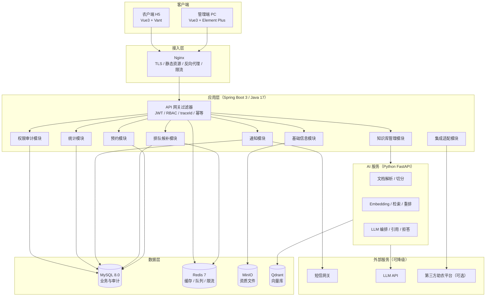
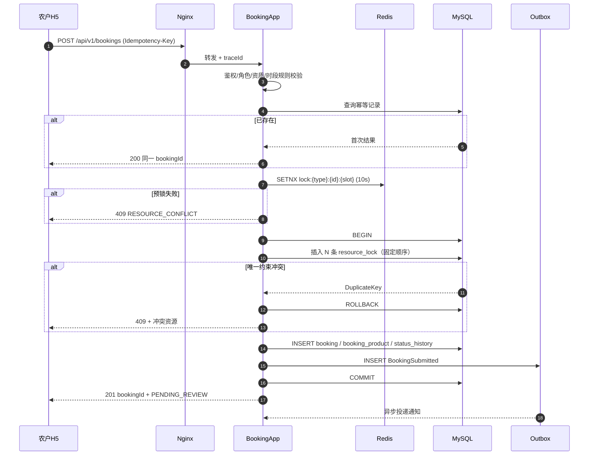
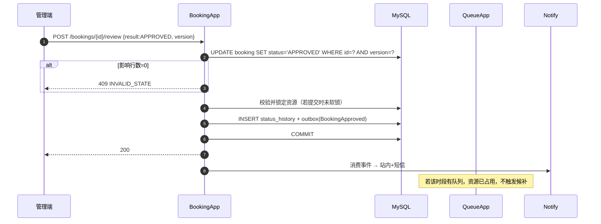
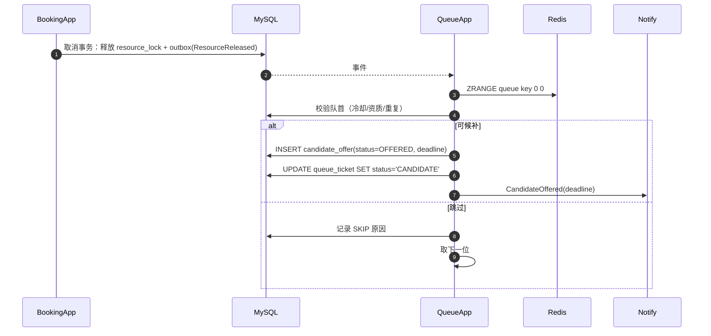
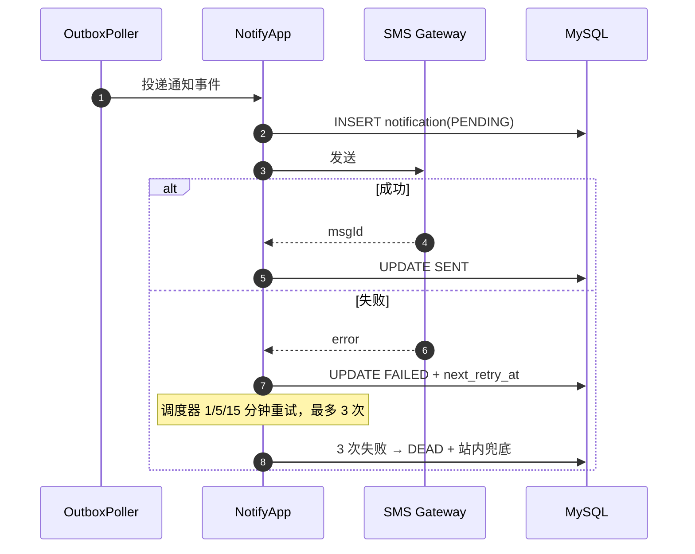
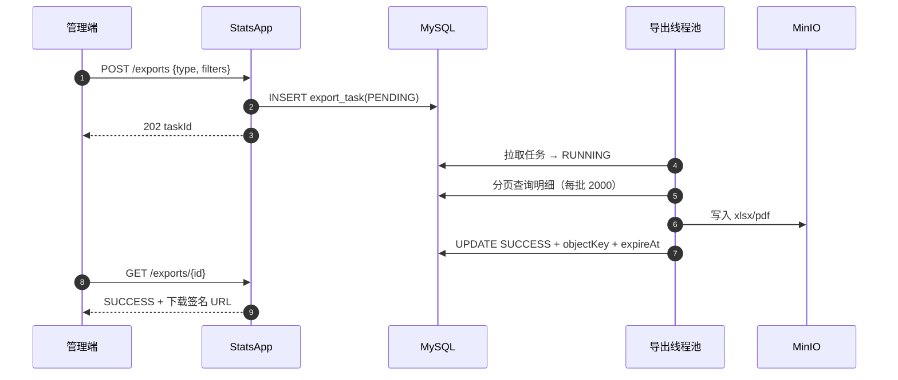
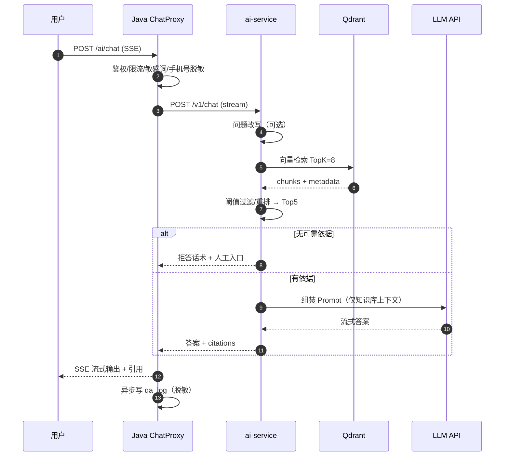
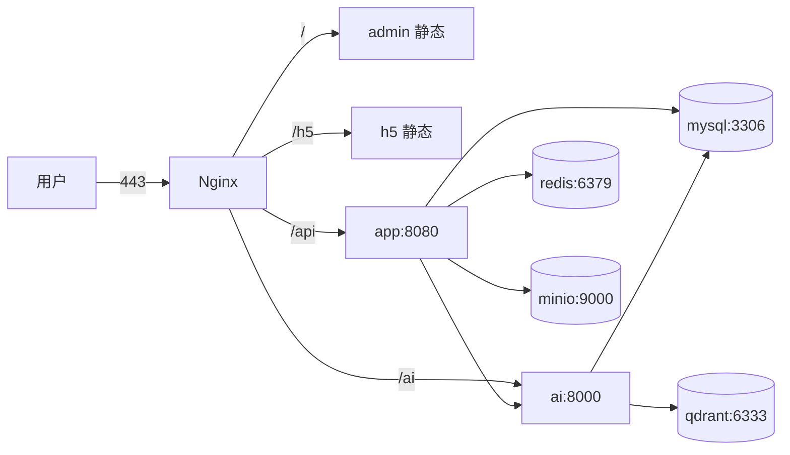

# 助农直播管理系统 · 系统架构设计

| 项 | 内容 |
|---|---|
| 文档编号 | D2-01 |
| 版本 | v1.0 |
| 编制/审核 | P2 / P1 |
| 关联 | SRS R1-01、规则 R1-02、选型 D2-02、库表 D2-03、API D2-04 |
| 架构风格 | 模块化单体（Modular Monolith）+ 独立 AI 服务 |

---

## 1. 设计目标与约束

| 目标 | 架构响应 |
|---|---|
| 预约零超卖 | 数据库唯一约束裁决 + 固定锁顺序 + 乐观锁 |
| 排队公平、实时 | FIFO + Redis ZSET 加速 + DB 权威对账 |
| 敏感数据可控 | 应用层加密 + 脱敏视图 + 字段级权限 + 审计 |
| 外部依赖可降级 | 适配器 + 降级链 + 开关 + 本地模拟 |
| 6 人团队可维护 | 单体优先、模块边界清晰、一套部署包 |
| 可扩展 | 模块化包结构、API 版本化、事件解耦、AI 独立服务 |

**约束**：16 周、3 名开发、单台 4C8G、无重型中间件、注释率 ≥50%、合规零容忍。

---

## 2. 架构总览



### 2.1 逻辑分层

```text
Controller（HTTP/DTO/校验）
   ↓
Application（用例编排/事务边界/权限）
   ↓
Domain（实体/值对象/领域服务/规则）
   ↓
Infrastructure（Mapper/Redis/文件/短信/LLM/外部适配）
```

- **依赖方向单向向下**；Domain 不依赖 Spring/MyBatis。
- 跨模块只调用对方 `application` 暴露的接口，禁止直接访问对方 Mapper。
- 所有写操作在 Application 层开事务；Domain 不感知事务。

---

## 3. 关键技术决策（ADR）

### ADR-001 采用模块化单体，而非微服务
- **背景**：3 名开发、16 周、单机部署；业务模块间强一致（预约↔资源↔排队）。
- **决策**：单一 Spring Boot 应用，按业务分 8 个包，包间通过接口与领域事件解耦。
- **理由**：避免分布式事务、服务治理、链路追踪的额外成本；强一致场景用本地事务最稳。
- **代价**：单点部署；模块边界靠评审与 ArchUnit 约束，可能腐化。
- **备选**：微服务（否决：团队规模不匹配）；纯单体不分模块（否决：难扩展）。

### ADR-002 后端 Java 17 + Spring Boot 3.2.x
- **理由**：事务/并发/生态成熟；团队课程背景匹配；Spring Security、Validation、Scheduling 开箱即用。
- **备选**：Django（开发快，但高并发锁与事务控制弱于 JVM 生态，且团队 Java 更熟）。

### ADR-003 前端 Vue 3 + TypeScript，双端两应用
- **决策**：`apps/admin`（Element Plus）+ `apps/h5`（Vant 4），pnpm workspace 共享 `api-client` 与类型。
- **理由**：管理端重表格/表单，农户端重轻量触屏；两套组件库各自最优，避免一套响应式硬扛两端。
- **代价**：多一个构建产物；共享层需约束。

### ADR-004 MySQL 8.0 + Redis 7
- **MySQL**：强一致、事务、唯一约束；金额/时间/状态唯一事实源。
- **Redis**：只做缓存、ZSET 排队加速、限流、分布式锁辅助；**不做事实源**。
- **备选**：PostgreSQL（pgvector 可省向量库，但团队 MySQL 更熟）；MongoDB（否决：事务与关系查询不匹配）。

### ADR-005 资源占用以 `resource_lock` 唯一约束裁决
- **决策**：按"小时槽 × 资源"落行，`UNIQUE(resource_type, resource_id, slot_start, active_flag)`。
- **理由**：把并发正确性交给数据库，应用层无需分布式锁；可审计、可复算。
- **代价**：一次 4 小时预约写 8 行（设备+场地），行数增长可控（20 万预约 × 平均 6 行 ≈ 120 万行/年）。

### ADR-006 事务性 Outbox + 调度轮询，替代 MQ
- **决策**：业务事务内写 `outbox_event`；调度器每 5 秒拉取投递；失败重试；消费幂等。
- **理由**：不引入 RabbitMQ/RocketMQ，减少运维；满足"业务成功则事件最终成功"。
- **代价**：秒级延迟（可接受）；轮询压力（索引 + 批量）。
- **升级路径**：量级上来可替换为 RocketMQ，消费端接口不变。

### ADR-007 AI 能力独立为 Python 服务
- **决策**：`ai-service`（FastAPI + LangChain）负责解析/切分/Embedding/检索/生成；Java 通过 REST + SSE 调用。
- **理由**：文档解析与 RAG 生态在 Python 更成熟；AI 故障不拖垮主业务；可独立限流与降级。
- **代价**：多一套语言与部署；需定义稳定契约。
- **备选**：LangChain4j 内嵌（若 Python 人力不足，作为 Plan B，接口不变）。

### ADR-008 资质文件 MinIO + 应用层加密
- **决策**：文件存 MinIO 私有桶，上传时 AES-256-GCM 加密，下载用 15 分钟签名 URL。
- **理由**：对象存储比数据库 BLOB 更适合大文件；加密满足合规；签名 URL 防直链。
- **注意**：MinIO 为 AGPLv3，课程/内部使用无碍；若商业分发需评估替代（SeaweedFS/Ceph）。

### ADR-009 报表导出异步任务
- **决策**：`export_task` 表 + 线程池；前端轮询任务状态；文件存 MinIO，24 小时过期。
- **理由**：5 万行导出耗时不可控，同步会拖垮请求线程；异步可重试、可限流。

### ADR-010 Monorepo + Docker Compose 交付
- **决策**：一个仓库含 `backend/`、`ai-service/`、`frontend/`、`deploy/`、`docs/`；Compose 一键起。
- **理由**：6 人团队协作成本最低；版本一致；交付简单。
- **代价**：CI 需路径过滤，避免全量构建。

---

## 4. 模块划分与依赖

| 模块 | 职责 | 对外接口 | 依赖 |
|---|---|---|---|
| `base` | 农户、资质、设备、场地、资源查询 | `FarmerService`、`ResourceService` | auth |
| `booking` | 预约提交/审核/调整/取消/状态机 | `BookingService` | base、auth、notify |
| `queue` | 排队、顺位、候补、冷却 | `QueueService`、`CandidateService` | booking、base、notify |
| `notify` | 模板、站内、短信、重试 | `NotifyService` | auth |
| `stats` | 指标、报表、导出 | `StatsService`、`ExportService` | booking、base |
| `auth` | 登录、RBAC、数据权限、审计 | `AuthService`、`AuditService` | — |
| `kb` | 知识库管理、问答代理 | `KbService`、`ChatService` | auth、ai-service |
| `integration` | 第三方同步（可选） | `FarmSyncService` | base |

**允许依赖**：`booking → base/auth/notify`；`queue → booking/base/notify`；`stats → booking/base`；`kb → auth`。
**禁止**：`base → booking`；任何模块 → `stats`；`notify → booking`（只收事件，不反查业务写接口）。
**约束工具**：ArchUnit 单测校验包依赖，CI 失败即阻断。

### 4.1 领域事件

| 事件 | 生产者 | 消费者 | 用途 |
|---|---|---|---|
| `BookingSubmitted` | booking | notify | 通知管理员待审核 |
| `BookingApproved` | booking | notify、stats | 通知农户；统计增量 |
| `BookingRejected` | booking | notify | 通知农户（含原因/推荐时间） |
| `BookingCancelled` | booking | queue、notify | 释放资源触发候补 |
| `BookingAdjusted` | booking | queue、notify | 换资源触发候补 |
| `ResourceReleased` | booking | queue | 触发候补 |
| `QueuePositionChanged` | queue | notify | 顺位更新通知 |
| `CandidateOffered` | queue | notify | 候补确认提醒 |
| `CandidateExpired` | queue | queue、notify | 顺延下一位 |
| `DeviceFaulted` | base | notify | 设备故障预警 |
| `ExportCompleted` | stats | notify | 导出完成通知 |

事件统一走 `outbox_event`，消费端幂等（`event_id + consumer` 唯一）。

---

## 5. 核心流程时序

### 5.1 预约提交（含冲突）



### 5.2 审核通过



### 5.3 资源释放 → 候补



### 5.4 通知失败重试



### 5.5 统计与导出



### 5.6 RAG 问答



---

## 6. 关键机制

### 6.1 鉴权与数据权限
- JWT（access 2h / refresh 7d）+ Redis 黑名单。
- 接口级：`@PreAuthorize` + 权限码；数据级：MyBatis 拦截器追加 `county_code` / `farmer_id` 条件。
- 敏感操作：Redis 中的 step-up token（5 分钟）二次校验。

### 6.2 幂等
- 客户端传 `Idempotency-Key`；服务端 `idempotency_record(key, user_id, response, expire_at)` 唯一索引。
- 业务幂等：状态机 + 唯一索引 + 版本号。

### 6.3 事务与锁
- 事务只包 DB 操作；外部调用（短信/LLM）在事务外，经 Outbox。
- 锁顺序固定：`resource_type, resource_id, slot_start` 升序。
- 死锁重试 1 次；仍失败返回 409 并记录。

### 6.4 缓存
| 缓存 | Key | TTL | 失效 |
|---|---|---|---|
| 资源可用列表 | `avail:{county}:{date}:{slot}` | 30s | 预约/审核/状态变更删除 |
| 字典/配置 | `cfg:{key}` | 10min | 配置更新删除 |
| 用户权限 | `perm:{userId}` | 5min | 角色变更删除 |
| 排队 ZSET | `queue:z:{device}:{date}:{slot}` | 无 | 事件驱动 |
| 登录失败计数 | `login:fail:{account}` | 15min | 成功登录清零 |

> **禁止**缓存预约详情/手机号等敏感数据。

### 6.5 文件上传
- 类型白名单 + 魔数校验 + 大小限制；文件名重命名（UUID）；病毒扫描可选（ClamAV）。
- 私有桶；下载走签名 URL；资质文件加密存储。

### 6.6 限流
- Nginx 层：IP 级 20 req/s；应用层：用户级 10 req/s（Redis 令牌桶）。
- 登录/短信/问答单独更严：登录 5 次/分钟；短信 1 条/分钟/用户；问答 10 次/分钟。

---

## 7. 集成与降级

| 依赖 | 主 | 备 | 兜底 | 开关 |
|---|---|---|---|---|
| 短信 | 阿里云 | 腾讯云 | 站内 + 人工清单 | `sms.enabled` |
| LLM | DeepSeek | 通义千问 | FAQ 关键词 + 人工 | `ai.llm.enabled` |
| Embedding | API（bge-m3） | 本地 bge-small | 关键词检索 | `ai.embedding.local` |
| 向量库 | Qdrant | Chroma（开发） | MySQL 全文 like | `ai.vector.enabled` |
| 文件 | MinIO | 本地磁盘（开发） | — | `storage.type` |
| 第三方同步 | 助农平台 | — | 手工导入 | `integration.farm-sync.enabled` |

**降级原则**：降级不阻断主业务；用户可见"能力受限"提示；降级事件打点告警。

---

## 8. 定时任务

| 任务 | 频率 | 说明 | 幂等键 |
|---|---|---|---|
| Outbox 投递 | 5s | 批量 100 条 | event_id |
| 通知重试 | 1min | 扫描 `next_retry_at <= now` | notification_id + attempt |
| 开播提醒 | 5min | 扫描 T-60±5min | booking_id + T-60 |
| 候补超时 | 1min | `deadline <= now` | offer_id |
| 排队关闭 | 10min | 开始后未转正 | queue_id |
| 审核 SLA | 1h | 待审核 >24h | booking_id + date |
| 校准提醒 | 每日 08:00 | 7 天内到期 | device_id + date |
| 统计日报 | 每日 02:00 | T-1 汇总 | stat_date |
| 对账 | 每日 02:30 | 日报 vs 实时 | stat_date |
| 日志哈希链 | 每日 00:10 | 前一日 | log_date |
| 导出清理 | 每日 03:00 | 过期文件 | task_id |
| 第三方同步 | 30min | 开关开启时 | sync_batch |

**多实例安全**：ShedLock（DB 表）保证同一任务仅一个实例执行；V1 单实例但按多实例设计。

---

## 9. 性能与容量

### 9.1 目标
| 场景 | 目标 |
|---|---|
| 预约提交 | P95 ≤800ms，20 TPS |
| 资源查询 | P95 ≤1.5s，200 并发浏览 |
| 审核列表 | P95 ≤1.5s，10 万数据 |
| 统计查询 | P95 ≤3s，20 万预约 |
| 导出 | 5 万行 ≤60s（异步） |
| 问答首字 | P95 ≤5s |

### 9.2 容量假设
- 农户 1 万、设备 2 千、场地 200、预约 20 万/年、排队 10 万/年、通知 100 万/年、日志 100 万/年。
- 单表 500 万行以内；`operation_log`/`notification` 按月分区或归档。

### 9.3 手段
- 索引：见 D2-03；禁止 `SELECT *`；分页深翻用游标（`id > lastId`）。
- 连接池：Hikari max 20；MySQL `innodb_buffer_pool_size=2G`。
- 缓存：热点查询 30s；权限 5min。
- 异步：通知、导出、统计日报。
- 限流：Nginx + 应用双层。
- JVM：`-Xms1g -Xmx2g -XX:+UseG1GC`。

### 9.4 扩容路径
1. 应用无状态 → 加实例 + Nginx 轮询（ShedLock 保证任务单跑）。
2. MySQL 读写分离（统计走从库）。
3. 向量库独立主机；AI 服务独立扩容。
4. Outbox 换 MQ。

---

## 10. 部署拓扑

### 10.1 环境
| 环境 | 规格 | 用途 | 数据 |
|---|---|---|---|
| 开发 dev | 本机 Docker | 日常 | 种子数据 |
| 测试 test | 2C4G | 集成/回归 | 脱敏测试数据 |
| 预发布 staging | 4C8G | 性能/安全/UAT | 生产同构 |
| 生产 prod | 4C8G | 演示/试运行 | 真实/演示数据 |

### 10.2 生产拓扑（单机 Compose）



| 服务 | 镜像 | 内存 | 端口（仅内网） |
|---|---|---|---|
| nginx | nginx:1.24-alpine | 128M | 80/443 |
| app | 自建 `farm/app:v1.0` | 2G | 8080 |
| ai | 自建 `farm/ai:v1.0` | 1.5G | 8000 |
| mysql | mysql:8.0 | 2G | 3306 |
| redis | redis:7.2-alpine | 512M | 6379 |
| minio | minio/minio | 512M | 9000/9001 |
| qdrant | qdrant/qdrant:v1.9 | 512M | 6333 |

> 4C8G 下 AI + 向量库偏紧：演示期可将 `ai` 切为远程 LLM + 轻量向量库；或临时升配 8C16G（预算外需审批）。

### 10.3 网络与安全
- 仅 80/443 对外；数据库/Redis/MinIO/Qdrant 不暴露公网。
- 安全组白名单；SSH 仅密钥登录；定期打补丁。
- TLS：Let's Encrypt 自动续期；HSTS。

---

## 11. 可观测性

| 维度 | 方案 |
|---|---|
| 日志 | JSON 结构化，含 `traceId/userId/module`；文件轮转 30 天 |
| 指标 | Actuator + Micrometer：QPS、P95、错误率、连接池、JVM、队列积压 |
| 追踪 | `traceId` 网关生成，响应头返回，日志透传；跨服务 HTTP Header 传递 |
| 健康 | `/actuator/health`（DB/Redis/MinIO/Qdrant） |
| 告警 | 5xx >1%、P95 超阈值、Outbox 积压 >1000、通知 DEAD >10、LLM 成功率 <95% |
| 看板 | Grafana（可选）：业务指标 + 系统指标 |

---

## 12. 扩展性设计

| 扩展点 | 方式 |
|---|---|
| 新增统计指标 | 新增 `stat_daily` 字段 + 计算器，不改核心表 |
| 新增通知渠道 | 实现 `NotifyChannel` 接口 + 配置 |
| 新增角色 | RBAC 数据驱动，不改代码 |
| 接入新 LLM | `LlmProvider` 适配器 + 路由配置 |
| 第三方平台 | `integration` 模块适配器 + 开关 |
| 数据量增长 | 分区/归档/读写分离，API 不变 |
| 服务拆分 | 模块边界即拆分边界，事件已解耦 |

---

## 13. 架构风险与权衡

| 风险 | 影响 | 缓解 |
|---|---|---|
| 单机单点 | 全站不可用 | 每日备份 + 快速重建脚本 + 演示录屏 |
| AI 服务拖内存 | OOM | 限流 + 独立重启策略 + 可关闭 |
| Outbox 轮询延迟 | 通知延迟秒级 | 5s 间隔 + 批量 + 监控积压 |
| 模块腐化 | 维护成本上升 | ArchUnit + 评审 + 包结构约定 |
| 4C8G 偏紧 | 压测不达标 | 分环境部署；AI 远程化；升配预案 |

---

## 14. 修订记录

| 版本 | 日期 | 修改人 | 说明 |
|---|---|---|---|
| v1.0 | 2026-10-19 | P2 | 首版：架构、10 项 ADR、6 个时序、降级与部署 |
