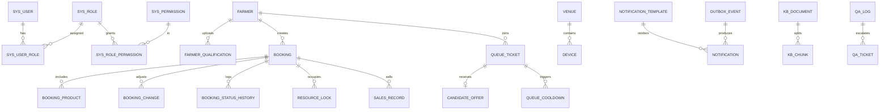

# 助农直播管理系统 · 数据库设计

| 项 | 内容 |
|---|---|
| 文档编号 | D2-03 |
| 版本 | v1.0 |
| 编制/审核 | P2 / P4 |
| 数据库 | MySQL 8.0，`utf8mb4`，InnoDB |
| 表数量 | 33 张（业务 20 + 权限审计 8 + AI 5） |
| 迁移工具 | Flyway（`db/migration/V{version}__{desc}.sql`） |

---

## 1. 设计原则

1. **状态与事实分离**：`booking` 存当前状态，`booking_status_history` 存流转轨迹；统计从事实表复算。
2. **并发交给数据库**：唯一约束 + 行锁 + 乐观锁，禁止依赖应用层"先查后写"。
3. **敏感字段最小化**：不建身份证/住址/银行卡字段；手机号加密 + 掩码 + HMAC 检索。
4. **逻辑删除**：业务主表带 `deleted_at`；审计与流水表不删除。
5. **统一字段**：`id BIGINT`、`created_at/updated_at DATETIME(3)`、`version INT`、`created_by/updated_by`。
6. **时间**：存储 UTC（`DATETIME`），`slot_date` 为业务本地日期（Asia/Shanghai）；API 输出 `+08:00`。
7. **枚举**：数据库用 `VARCHAR` 存英文码，应用层枚举校验；禁止魔法数字。
8. **禁止**：外键强约束（保留索引，应用层保证）、`SELECT *`、大字段进主表、JSON 存核心查询字段。

---

## 2. 命名与类型规范

| 对象 | 规则 | 示例 |
|---|---|---|
| 表 | 小写下划线，单数 | `booking`、`queue_ticket` |
| 字段 | 小写下划线 | `slot_start`、`county_code` |
| 主键 | `id` | `id BIGINT` |
| 唯一索引 | `uk_<字段>` | `uk_booking_no` |
| 普通索引 | `idx_<字段组>` | `idx_status_start` |
| 布尔 | `is_` / `_flag` | `built_in`、`active_flag` |
| 金额/数量 | `DECIMAL(14,2)` | `sales_qty` |
| 时间 | `DATETIME(3)` | `created_at` |
| 枚举 | `VARCHAR(20)` | `PENDING_REVIEW` |

---

## 3. ER 总览（核心实体）



---

## 4. 表结构

### 4.1 权限与用户（7 张）

#### `sys_user` 用户
| 字段 | 类型 | 约束 | 说明 |
|---|---|---|---|
| id | BIGINT | PK | |
| username | VARCHAR(50) | UK | 登录名 |
| password_hash | VARCHAR(100) | NOT NULL | Argon2id/bcrypt |
| real_name | VARCHAR(50) | | |
| phone_cipher | VARCHAR(512) | | 加密手机号（base64 nonce+ct+tag） |
| phone_mask | VARCHAR(20) | | `138****5678` |
| role_code | VARCHAR(32) | NOT NULL | 冗余主角色，便于鉴权 |
| farmer_id | BIGINT | NULL | 农户角色关联 |
| county_code | CHAR(6) | NULL | 数据范围 |
| status | VARCHAR(20) | | ACTIVE/LOCKED/DISABLED |
| fail_count | INT | DEFAULT 0 | 登录失败次数 |
| locked_until | DATETIME(3) | NULL | |
| last_login_at | DATETIME(3) | NULL | |
| version | INT | DEFAULT 0 | |
| created_at / updated_at | DATETIME(3) | | |
| deleted_at | DATETIME(3) | NULL | |

索引：`uk_username`、`uk_farmer_id`、`idx_county_status`。

#### `sys_role`
`id`、`code`（UK，SYS_ADMIN/LIVE_ADMIN/FARMER/STAT_VIEWER）、`name`、`description`、`built_in`、`created_at`。

#### `sys_permission`
`id`、`code`（UK，如 `booking:review`）、`name`、`type`（MENU/BUTTON/API）、`parent_id`、`path`、`sort`、`created_at`。

#### `sys_user_role`
`user_id`、`role_id`，联合 PK；`idx_role`。

#### `sys_role_permission`
`role_id`、`permission_id`，联合 PK；`idx_permission`。

#### `sys_config`
`config_key`（PK）、`config_value`、`value_type`、`description`、`editable`、`updated_by`、`updated_at`、`version`。
> 启动时加载到内存 + Redis；更新走二次验证并写审计。

#### `operation_log` 操作日志（按月分区）
| 字段 | 类型 | 说明 |
|---|---|---|
| id | BIGINT | 与 created_at 组成 PK |
| trace_id | CHAR(26) | 全链路 |
| user_id / username / role_code | | 操作人 |
| action | VARCHAR(64) | 如 `BOOKING_APPROVE` |
| module | VARCHAR(32) | |
| resource_type / resource_id | | 对象 |
| content | VARCHAR(1000) | 可读描述 |
| before_json / after_json | JSON | 敏感操作必填 |
| ip | VARCHAR(45) | IPv4/IPv6 |
| user_agent | VARCHAR(255) | |
| result | TINYINT | 1 成功 0 失败 |
| error_msg | VARCHAR(500) | |
| prev_hash / chain_hash | CHAR(64) | 哈希链 |
| created_at | DATETIME(3) | 分区键 |

索引：`idx_user_time`、`idx_action_time`、`idx_trace`。应用账号仅有 INSERT/SELECT 权限。

#### `audit_chain` 日志链锚点
`id`、`chain_date`（UK）、`root_hash`、`record_count`、`created_at`。

---

### 4.2 基础信息（4 张）

#### `farmer` 农户
| 字段 | 类型 | 约束 | 说明 |
|---|---|---|---|
| id | BIGINT | PK | |
| farmer_no | VARCHAR(20) | UK | `NF2025001` |
| name | VARCHAR(50) | NOT NULL | |
| county_code | CHAR(6) | NOT NULL | |
| county_name | VARCHAR(50) | NOT NULL | 冗余便于展示 |
| phone_cipher | VARCHAR(512) | NOT NULL | 加密 |
| phone_mask | VARCHAR(20) | NOT NULL | 掩码 |
| phone_hash | CHAR(64) | | HMAC-SHA256，精确检索 |
| status | VARCHAR(20) | NOT NULL | PENDING/CERTIFIED/REJECTED/DISABLED |
| cert_expire_at | DATE | NULL | 资质到期 |
| remark | VARCHAR(500) | | |
| created_by / updated_by | BIGINT | | |
| version | INT | | |
| created_at / updated_at | DATETIME(3) | | |
| deleted_at | DATETIME(3) | NULL | |

索引：`uk_farmer_no`、`idx_county_status`、`idx_name`、`idx_phone_hash`。
> **禁存字段检查**：CI 执行脚本校验 information_schema 中不存在 `id_card`、`id_no`、`address`、`bank_card` 等列。

#### `farmer_qualification`
`id`、`farmer_id`、`type`（LICENSE/INSPECTION）、`file_key`、`file_hash`、`file_size`、`mime`、`status`（PENDING/APPROVED/REJECTED）、`reviewer_id`、`review_reason`、`reviewed_at`、`expire_at`、`created_at`。
索引：`idx_farmer_status`、`idx_file_hash`。

#### `venue` 场地
`id`、`venue_no`（UK，`C001`）、`name`、`county_code`、`location`、`capacity`、`open_start TIME`、`open_end TIME`、`status`（OPEN/CLOSED）、`equipment_note`、`version`、`created_at/updated_at`。

#### `device` 设备
`id`、`device_no`（UK，`ZB-C001-01`）、`name`、`model`、`venue_id`、`status`（AVAILABLE/MAINTENANCE/DISABLED/OCCUPIED）、`calibration_cycle_days`、`last_calibration_at`、`next_calibration_at`、`fault_reason`、`expected_recover_at`、`version`、`created_at/updated_at/deleted_at`。
索引：`uk_device_no`、`idx_venue_status`、`idx_next_calibration`。

---

### 4.3 预约（6 张）

#### `booking` 预约主表
| 字段 | 类型 | 说明 |
|---|---|---|
| id | BIGINT PK | |
| booking_no | VARCHAR(24) UK | `Y202510150001` |
| farmer_id | BIGINT | |
| county_code | CHAR(6) | |
| theme | VARCHAR(100) | 2–50 字 |
| venue_id / device_id | BIGINT | 绑定的资源 |
| slot_date | DATE | 本地业务日期 |
| start_time / end_time | DATETIME(3) | UTC，半开区间 |
| status | VARCHAR(20) | 见状态机 |
| source | VARCHAR(10) | H5/ADMIN |
| review_comment | VARCHAR(500) | |
| recommended_start | DATETIME(3) | 驳回推荐时间 |
| reviewed_by / reviewed_at | | |
| cancel_reason / cancel_note | | 取消原因 |
| completed_at | DATETIME(3) | |
| version | INT | 乐观锁 |
| created_at / updated_at / deleted_at | | |

索引：`uk_booking_no`、`idx_farmer_start`、`idx_status_start`、`idx_county_start`、`idx_device_start`、`idx_slot_date`。

#### `booking_product`
`id`、`booking_id`、`name`、`spec`、`sort`；`idx_booking`。

#### `booking_change` 调整单
`id`、`change_no`（UK）、`booking_id`、`type`、`before_json`、`after_json`、`reason`、`status`、`active_flag`（PENDING 时=1，否则 NULL）、`reviewer_id`、`review_reason`、`applied_at`、`reviewed_at`、`version`。
唯一：`uk_change_active(booking_id, active_flag)` 保证同时仅 1 条待审批。

#### `booking_status_history`
`id`、`booking_id`、`from_status`、`to_status`、`operator_id`、`operator_role`、`reason`、`trace_id`、`created_at`；`idx_booking_time`。

#### `resource_lock` 资源占用（核心）
```sql
CREATE TABLE resource_lock (
  id            BIGINT       NOT NULL AUTO_INCREMENT,
  resource_type VARCHAR(8)   NOT NULL COMMENT 'DEVICE/VENUE',
  resource_id   BIGINT       NOT NULL,
  slot_start    DATETIME(3)  NOT NULL COMMENT 'UTC 小时槽起点',
  booking_id    BIGINT       NOT NULL,
  status        VARCHAR(16)  NOT NULL COMMENT 'LOCKED/RELEASED',
  active_flag   TINYINT GENERATED ALWAYS AS
                (IF(status = 'LOCKED', 1, NULL)) STORED,
  created_at    DATETIME(3)  NOT NULL,
  released_at   DATETIME(3)  NULL,
  PRIMARY KEY (id),
  UNIQUE KEY uk_resource_slot (resource_type, resource_id, slot_start, active_flag),
  KEY idx_booking (booking_id),
  KEY idx_slot (slot_start)
) ENGINE=InnoDB DEFAULT CHARSET=utf8mb4;
```
> 这是"不超卖"的最终裁决；应用层 Redis 仅前置拦截。

#### `idempotency_record`
`id`、`idem_key`、`user_id`、`api`、`request_hash`、`response_code`、`response_body JSON`、`expire_at`、`created_at`。
唯一：`uk_idem(idem_key, user_id)`；`idx_expire`。

---

### 4.4 排队与候补（4 张）

#### `queue_ticket` 排队票
| 字段 | 类型 | 说明 |
|---|---|---|
| id | BIGINT PK | |
| queue_no | VARCHAR(40) UK | `Q-NF2025001-20261020-001` |
| farmer_id | BIGINT | |
| device_id / venue_id | BIGINT | |
| slot_date | DATE | |
| slot_start / slot_end | DATETIME(3) | |
| theme | VARCHAR(100) | |
| status | VARCHAR(20) | WAITING/CANDIDATE/CONFIRMED/EXPIRED/ABANDONED/CANCELLED/CLOSED |
| queue_seq | INT | 维度内序号 |
| active_flag | TINYINT GENERATED | WAITING/CANDIDATE=1，否则 NULL |
| created_at / updated_at | DATETIME(3) | |
| closed_at | DATETIME(3) | |
| version | INT | |

唯一：`uk_queue_no`、`uk_queue_active(farmer_id, device_id, slot_start, active_flag)`。
索引：`idx_group(device_id, slot_date, slot_start, status, created_at)`。

#### `queue_seq` 序号发生器
`group_key VARCHAR(100) PK`（`{deviceId}:{slotDate}:{slotStart}`）、`next_val BIGINT`、`updated_at`。
> `UPDATE queue_seq SET next_val = LAST_INSERT_ID(next_val + 1) WHERE group_key=?` 取号；无记录则插入 1。

#### `candidate_offer` 候补邀约
| 字段 | 类型 | 说明 |
|---|---|---|
| id | BIGINT PK | |
| offer_no | VARCHAR(32) UK | |
| queue_id | BIGINT | |
| device_id / venue_id | BIGINT | |
| slot_start / slot_end | DATETIME(3) | |
| status | VARCHAR(20) | OFFERED/CONFIRMED/DECLINED/EXPIRED/SKIPPED |
| active_flag | TINYINT GENERATED | OFFERED=1 |
| deadline | DATETIME(3) | 精确到分钟 |
| responded_at | DATETIME(3) | |
| skip_reason | VARCHAR(100) | |
| created_at | DATETIME(3) | |

唯一：`uk_offer_active(device_id, slot_start, active_flag)`（同一资源槽仅 1 个有效邀约）、`uk_queue_active(queue_id, active_flag)`。

#### `queue_cooldown` 冷却
`id`、`farmer_id`、`device_id`、`until`、`reason`、`source_queue_id`、`created_at`。
唯一：`uk_farmer_device(farmer_id, device_id)`（保留最新，upsert）。

---

### 4.5 通知（3 张）

#### `notification`
`id`、`notification_no`（UK）、`user_id`、`event_type`、`event_key`（幂等）、`channel`（IN_APP/SMS）、`title`、`content`、`payload JSON`、`status`（PENDING/SENT/FAILED/DEAD）、`retry_count`、`next_retry_at`、`provider_msg_id`、`error_msg`、`sent_at`、`read_at`、`expire_at`、`created_at`。
唯一：`uk_event_channel(event_key, user_id, channel)`；索引：`idx_user_read`、`idx_status_retry`。

#### `notification_template`
`id`、`code`（UK）、`name`、`channel`、`title_tpl`、`content_tpl`、`variables JSON`、`enabled`、`provider_template_id`、`version`、`updated_by/updated_at`。

#### `outbox_event`
`id`、`event_id`（UK）、`event_type`、`aggregate_type`、`aggregate_id`、`payload JSON`、`status`（NEW/SENT/FAILED）、`retry_count`、`next_retry_at`、`created_at`、`sent_at`。
索引：`idx_status_next(status, next_retry_at)`。

---

### 4.6 统计与导出（3 张）

#### `stat_daily`
`id`、`stat_date`、`dimension_type`（OVERALL/COUNTY/PRODUCT/DEVICE）、`dimension_key`、`booking_total`、`approved_total`、`completed_total`、`rejected_total`、`success_rate DECIMAL(6,4)`、`occupancy_rate DECIMAL(6,4)`、`sales_qty DECIMAL(14,2)`、`candidate_confirmed`、`candidate_expired`、`avg_wait_seconds`、`created_at`。
唯一：`uk_stat(stat_date, dimension_type, dimension_key)`。

#### `export_task`
`id`、`task_no`（UK）、`user_id`、`export_type`、`filters_json`、`status`、`row_count`、`file_key`、`file_size`、`error_msg`、`expire_at`、`created_at`、`finished_at`。
索引：`idx_user_created`、`idx_status`。

#### `sales_record` 销量（V1 手工/导入）
`id`、`booking_id`、`product_name`、`spec`、`qty DECIMAL(14,2)`、`unit`、`amount DECIMAL(14,2)`、`source`（MANUAL/IMPORT）、`recorded_by`、`recorded_at`、`remark`。
唯一：`uk_booking_product(booking_id, product_name, spec)`；索引 `idx_booking`。

---

### 4.7 知识库与问答（5 张）

#### `kb_document`
`id`、`doc_no`（UK）、`title`、`doc_type`（RULE/TRACE/FAQ）、`county_code`、`version_no`、`file_key`、`file_hash`（UK）、`mime`、`size`、`status`（UPLOADED/PARSING/PARSED/FAILED/DISABLED）、`chunk_count`、`effective_date`、`expire_date`、`uploaded_by`、`error_msg`、`created_at/updated_at`。

#### `kb_chunk`
`id`、`document_id`、`chunk_index`、`content TEXT`、`content_hash`、`token_count`、`metadata JSON`（标题/章节/页码）、`vector_id CHAR(36)`、`status`（ACTIVE/INACTIVE）、`created_at`。
唯一：`uk_doc_chunk(document_id, chunk_index)`；索引 `idx_vector`。

#### `qa_log`
`id`、`trace_id`、`user_id`、`role_code`、`question_masked`、`answer`、`citations JSON`、`retrieved_chunk_ids JSON`、`latency_ms`、`model`、`prompt_tokens`、`completion_tokens`、`feedback`、`handoff`、`created_at`。
> `question_masked` 写入前脱敏（手机号/身份证模式）；`answer` 截断 4000 字。

#### `qa_ticket`
`id`、`ticket_no`（UK）、`user_id`、`question`、`status`（OPEN/PROCESSING/CLOSED）、`assignee_id`、`reply`、`created_at`、`replied_at`、`closed_at`。

#### `eval_result`
`id`、`run_no`（UK）、`dataset_version`、`total`、`recall5 DECIMAL(5,4)`、`answer_accuracy DECIMAL(5,4)`、`citation_accuracy DECIMAL(5,4)`、`refusal_accuracy DECIMAL(5,4)`、`avg_latency_ms`、`passed`、`detail_json`、`created_at`。

---

## 5. 关键查询与索引验证

| 查询 | SQL 形态 | 索引 |
|---|---|---|
| 待审核列表 | `WHERE status='PENDING_REVIEW' ORDER BY created_at DESC` | `idx_status_start` |
| 农户我的预约 | `WHERE farmer_id=? AND deleted_at IS NULL ORDER BY start_time DESC` | `idx_farmer_start` |
| 县域时间范围 | `WHERE county_code=? AND start_time BETWEEN ? AND ?` | `idx_county_start` |
| 资源占用检查 | 唯一索引插入 | `uk_resource_slot` |
| 队列顺位 | `WHERE device_id=? AND slot_date=? AND slot_start=? AND status IN (...)` | `idx_group` |
| 通知重试 | `WHERE status='FAILED' AND next_retry_at<=?` | `idx_status_retry` |
| 日志查询 | `WHERE action=? AND created_at BETWEEN ? AND ?` | `idx_action_time` |
| 统计日报 | `WHERE stat_date=? AND dimension_type=?` | `uk_stat` |

**慢查询治理**：开启 `slow_query_log`（>500ms）；每周评审 Top10；禁止 `LIKE '%x%'` 于大表（农户姓名搜索用前缀/全文）。

---

## 6. 数据安全设计

| 数据 | 存储 | 展示 | 访问控制 |
|---|---|---|---|
| 手机号 | AES-256-GCM 密文 + HMAC 检索 + 掩码 | 列表掩码；本人/授权管理员二次验证后明文 | 字段级 + 审计 |
| 资质文件 | MinIO 加密对象（应用层 AES-GCM） | 15 分钟签名 URL | 管理员/本人 |
| 密码 | Argon2id/bcrypt(cost≥10) | 永不返回 | — |
| 身份证/住址/银行卡 | **不存** | — | CI 检查列名 |
| 日志中的手机号 | 写入前脱敏 | 掩码 | 管理员 |
| 问答问题 | 入库前脱敏 | 掩码 | 本人/管理员 |

**密钥管理**：`DATA_KEY`（AES）与 `HMAC_KEY` 从环境变量/密钥管理服务注入，禁止入库/入仓；每 12 个月轮换，轮换需重加密脚本与回滚。

---

## 7. 分区、归档与留存

| 表 | 策略 | 留存 |
|---|---|---|
| `operation_log` | 按月 RANGE 分区（`created_at`） | 在线 6 个月，归档 5 年（冷备） |
| `notification` | 按月分区（可选） | 180 天 |
| `outbox_event` | 按周清理 `SENT` | 30 天 |
| `export_task` | 文件 24 小时过期，记录 90 天 | — |
| `qa_log` | 180 天 | 脱敏后归档 |
| `resource_lock` | 不删除，`RELEASED` 保留 | 3 年 |
| `booking` | 不删除（逻辑删除） | 长期 |

---

## 8. 备份与恢复

| 项 | 方案 | 频率 | RPO/RTO |
|---|---|---|---|
| 全量备份 | `mysqldump --single-transaction --routines` → 压缩加密 → 对象存储 | 每日 01:00 | RPO 24h |
| 增量 | binlog 归档 | 实时/每小时 | RPO ≤15min |
| 文件 | MinIO 版本化 + 每日同步 | 每日 | RPO 24h |
| 恢复演练 | 测试环境还原 + 校验行数/关键数据 | 每月一次 | RTO ≤2h |
| 保留 | 全备 7 份、周备 4 份、月备 6 份 | — | — |

**恢复步骤**：见 [O5-01](../05_交付运维/01-部署与运维手册.md) §7。

---

## 9. 迁移与初始化

- 所有结构变更走 Flyway：`V1__init.sql`、`V2__add_queue.sql`…；**禁止**手工改生产库。
- 每次迁移必须提供回滚说明（MySQL DDL 不支持事务，采用"向前兼容 + 双写/影子表"）。
- 初始化数据：角色/权限/字典/配置/演示账号（`R__seed.sql` 可重复执行，使用 `INSERT ... ON DUPLICATE KEY UPDATE`）。
- 演示种子数据：20 农户、5 场地、10 设备、50 预约、3 类知识库文档（脚本 `seed/demo.sql`）。

---

## 10. 数据库规约（开发必读）

1. 禁止在代码中拼接 SQL；MyBatis 使用 `#{}`，禁止 `${}`（除非白名单排序字段）。
2. 事务内不做远程调用；事务超时 5 秒。
3. 批量插入每批 ≤500 条；导出分页每批 2000 条。
4. 更新必须带 `version` 或状态条件，禁止无条件 `UPDATE`。
5. 逻辑删除统一 `deleted_at IS NULL`；统计口径明确是否含删除。
6. 金额/数量用 `DECIMAL`，禁止 `FLOAT/DOUBLE`。
7. 时间比较统一 UTC；跨天判断用 `slot_date` + 本地时区。
8. 新增字段必须可空或给默认值，保证灰度兼容。

---

## 11. 修订记录

| 版本 | 日期 | 修改人 | 说明 |
|---|---|---|---|
| v1.0 | 2026-10-19 | P2/P4 | 首版：33 张表、核心 DDL、索引、加密、备份 |
